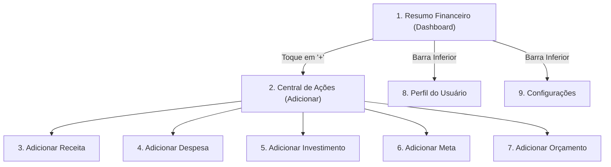

# ESPECIFICAÇÃO DE DESIGN & UX/UI — CONTROLE FINANCEIRO PESSOAL

**Projeto:** Aplicativo Web/Mobile de Controle Financeiro Pessoal  
**Autor:** Design Lead  
**Destinatários:** Dev Lead (`agent-b94c512e-5840-4f5f-ac5c-91153a08794f`), Big Boss (`agent-85d0ae59-de2b-487f-99a6-a9fe0ca54a9b`), Usuário (André)  
**Versão:** 1.0.0 — Pronta para Implementação  
**Data:** 07 de Novembro de 2026  
**Status:** Oficial / Aprovado para Front-end  

---

## 1. VISÃO GERAL E PRINCÍPIOS DE DESIGN

O aplicativo de **Controle Financeiro Pessoal** é uma aplicação web mobile-first de alta fidelidade voltada para a gestão de receitas, despesas, investimentos, metas e orçamentos.

### 1.1. Princípios Mandatórios
1. **Dark Mode Elegante e Minimalista:** Fundo grafite/noite profundo, eliminando contrastes agressivos e brilho excessivo. Sem gradientes chamativos de stock ou visual amador.
2. **Acentos em Azul-Petróleo Refinado:** Todo o destaque visual principal (botões de confirmação, item ativo da barra de navegação, chip/categoria selecionada, foco em campos e anel de progresso) utiliza estritamente tons refinados de **azul-petróleo**.
3. **Uso Restrito e Secundário do Dourado:** As referências visuais originais continham ícones dourados/bege. Na especificação final aprovada pelo usuário, o dourado fica restrito a detalhes pontuais informativos (por exemplo: ícone de saldo em reservas ou badge de status de investimento), nunca em botões principais de ação ou seleção ativa.
4. **Tipografia e Elementos Limpos:** Ausência total de fotos decorativas, mãos segurando cartões ou ilustrações poluídas. Ícones monoline de 24px com traço fino e consistente.
5. **Ergonomia Mobile (Thumb Zone):** Navegação inferior fixa com 4 itens e botão central destacado ("Adicionar"). Áreas mínimas de toque de **44px a 48px** com suporte nativo a safe area (`env(safe-area-inset-bottom)`).
6. **Mobile-First com Adaptação Desktop:** O container principal é centrado na tela em resoluções maiores (`max-width: 430px`), reproduzindo a experiência tátil de um aplicativo nativo premium.

---

## 2. DESIGN TOKENS EM HEXADECIMAL

### 2.1. Paleta de Cores

```css
:root {
  /* Fundo e Superfícies (Dark Noite Profundo / Grafite) */
  --color-bg-base: #0F1418;          /* Fundo geral da tela (noite escuro) */
  --color-bg-app: #141A20;           /* Container mobile centralizado */
  --color-surface-card: #1B232B;     /* Superfície de cards, modais e seções */
  --color-surface-elevated: #222C36; /* Cards elevados / dropdowns / popovers */
  --color-surface-input: #12181E;    /* Fundo de campos de digitação */
  --color-border-subtle: #2A3642;    /* Linhas divisórias e bordas padrão */
  --color-border-hover: #3E4F60;     /* Borda ao passar o mouse */

  /* Acento Principal: Azul-Petróleo Refinado (Ação, Destaque e Seleção) */
  --color-teal-primary: #0E8388;     /* Petróleo principal para botões e seleção */
  --color-teal-hover: #13979D;       /* Hover de botão primário */
  --color-teal-active: #0B6B6F;      /* Estado pressionado (active) */
  --color-teal-glow: rgba(14, 131, 136, 0.25); /* Glow sutil para foco */
  --color-teal-subtle: #16383E;      /* Fundo de chips selecionados e abas */
  --color-teal-border: #1F6B72;      /* Borda de elementos selecionados */

  /* Cores Semânticas de Estado Financeiro */
  --color-income: #2ECC71;           /* Verde esmeralda refinado para Receitas / Salário */
  --color-expense: #E74C3C;          /* Vermelho carmim para Despesas */
  --color-investment: #3498DB;       /* Azul para Investimentos / Dividendos */
  --color-gold-secondary: #D4AF37;   /* Dourado fosco (apenas detalhes secundários) */
  --color-warning: #F39C12;          /* Alerta / Atenção de Orçamento */
  --color-error: #E74C3C;            /* Erro de validação */

  /* Tipografia & Contraste (WCAG 2.1 AA/AAA) */
  --color-text-primary: #F0F4F8;     /* Quase branco puro (contraste > 12:1) */
  --color-text-secondary: #9BA9B7;   /* Cinza médio legível (contraste > 5.5:1) */
  --color-text-muted: #6B7B8C;       /* Rótulos auxiliares e placeholders */
  --color-text-inverse: #FFFFFF;     /* Texto sobre petróleo */

  /* Raios de Borda (Border Radius) */
  --radius-xs: 4px;
  --radius-sm: 8px;
  --radius-md: 12px;
  --radius-lg: 18px;
  --radius-xl: 24px;
  --radius-pill: 9999px;

  /* Sombras Sutis */
  --shadow-card: 0 4px 12px rgba(0, 0, 0, 0.35);
  --shadow-floating: 0 8px 28px rgba(0, 0, 0, 0.55);
  --shadow-teal-focus: 0 0 0 3px rgba(14, 131, 136, 0.4);

  /* Espaçamentos (Grid de 4px / 8px) */
  --space-2xs: 4px;
  --space-xs: 8px;
  --space-sm: 12px;
  --space-md: 16px;
  --space-lg: 20px;
  --space-xl: 24px;
  --space-2xl: 32px;

  /* Escala Tipográfica */
  --font-family-base: -apple-system, BlinkMacSystemFont, "Segoe UI", Roboto, "Helvetica Neue", Arial, sans-serif;
  --font-family-mono: "SF Mono", Menlo, Consolas, "Courier New", monospace;
  
  --font-size-2xs: 0.6875rem; /* 11px */
  --font-size-xs: 0.75rem;    /* 12px */
  --font-size-sm: 0.875rem;   /* 14px */
  --font-size-base: 1rem;     /* 16px */
  --font-size-md: 1.125rem;   /* 18px */
  --font-size-lg: 1.25rem;    /* 20px */
  --font-size-xl: 1.5rem;     /* 24px */
  --font-size-2xl: 2rem;      /* 32px - Valor monetário principal */
  --font-size-3xl: 2.25rem;   /* 36px */
}
```

---

## 3. LAYOUT, GRID E COMPORTAMENTO MOBILE-FIRST

### 3.1. Dimensões e Enquadramento
- **Viewport Alvo:** 360px a 430px de largura física (iPhone 13/14/15/16, Galaxy S/A, Pixel).
- **Container Desktop:**
  ```css
  body {
    background-color: var(--color-bg-base);
    color: var(--color-text-primary);
    font-family: var(--font-family-base);
    margin: 0;
    padding: 0;
    display: flex;
    justify-content: center;
  }
  .app-container {
    width: 100%;
    max-width: 430px;
    min-height: 100vh;
    background-color: var(--color-bg-app);
    position: relative;
    box-shadow: 0 0 40px rgba(0, 0, 0, 0.7);
    display: flex;
    flex-direction: column;
    padding-bottom: calc(72px + env(safe-area-inset-bottom, 16px));
  }
  ```

### 3.2. Barra Inferior Fixa (Bottom Navigation Bar)
- **Altura Total:** 64px + safe area inferior (`padding-bottom: env(safe-area-inset-bottom)`).
- **Fundo:** `var(--color-surface-card)` com borda superior `1px solid var(--color-border-subtle)` e `backdrop-filter: blur(12px)`.
- **4 Itens de Navegação:**
  1. **Resumo:** Ícone de dashboard (`◧` ou SVG layout) + rótulo "Resumo".
  2. **Adicionar (Botão Central Destacado):**
     - Botão retangular/arredondado elevado com acento visual petróleo (`background: var(--color-teal-primary); color: #FFF; width: 56px; height: 38px; border-radius: var(--radius-md); box-shadow: 0 2px 8px var(--color-teal-glow);`).
  3. **Perfil:** Ícone de usuário (`◎` ou SVG user) + rótulo "Perfil".
  4. **Configurações:** Ícone de engrenagem (`⚙` ou SVG gear) + rótulo "Configurações".
- **Estado Ativo:**
  - Ícone e rótulo na cor `var(--color-teal-primary)`.
  - Indicador sutil de 2px sob o item ou fundo de pill sutil em `var(--color-teal-subtle)`.

---

## 4. COMPONENTES DE DESIGN (SISTEMA DE COMPONENTES)

### 4.1. Campo de Valor Monetário (Hero Input)
Utilizado em todas as telas de Adicionar (Receita, Despesa, Investimento, Meta, Orçamento).
- **Estrutura:**
  - Rótulo superior: `VALOR DA RECEITA (R$) - Ex: 1500,00` em caixa alta, tamanho `11px`, `color: var(--color-text-muted)`.
  - Linha do valor: Símbolo `R$` em `var(--color-teal-primary)` seguido do input sem bordas laterais.
  - Linha inferior: `border-bottom: 1.5px solid var(--color-border-subtle);`. Ao focar: `border-bottom-color: var(--color-teal-primary); box-shadow: 0 1px 0 var(--color-teal-primary);`.
  - Tamanho da fonte: `32px` com `font-weight: 700`, alinhamento à esquerda.

### 4.2. Grade de Categorias (Chips Selecionáveis)
Grid de 3 ou 4 colunas para seleção ágil sem menus suspensos:
- **Tamanho do Item:** `min-height: 80px`, largura flexível (1fr).
- **Estrutura do Card de Categoria:**
  - Ícone monoline SVG de 24px centralizado no topo.
  - Rótulo em baixo com `font-size: 12px`, centralizado, quebra automática de linha.
- **Estado Normal:**
  - Fundo: `transparent` ou `var(--color-surface-card)`.
  - Borda: `1px solid transparent`.
  - Ícone e Texto: `color: var(--color-text-secondary)`.
- **Estado Selecionado (Active/Checked):**
  - Fundo: `var(--color-teal-subtle)`.
  - Borda: `1.5px solid var(--color-teal-primary)`.
  - Ícone e Texto: `color: var(--color-teal-primary); font-weight: 600;`.
  - Glow discreto: `box-shadow: 0 0 12px var(--color-teal-glow);`.

### 4.3. Botão Primário de Ação
- **Dimensões:** Largura 100%, `min-height: 48px`, padding `12px 20px`.
- **Estilo:**
  - `background: var(--color-teal-primary); color: #FFFFFF; font-size: 15px; font-weight: 600; text-transform: uppercase; letter-spacing: 0.5px; border: none; border-radius: var(--radius-md); cursor: pointer;`.
  - Hover: `background: var(--color-teal-hover);`.
  - Active: `background: var(--color-teal-active); transform: scale(0.99);`.

### 4.4. Alternância Anual / Mensal (Segmented Control)
- **Localização:** Cabeçalho do bloco de Fluxo de Caixa.
- **Container:** Pílula encapsulada com fundo `var(--color-surface-card)` e borda `var(--color-border-subtle)`.
- **Item Ativo:** Fundo `var(--color-teal-primary)`, texto branco, borda arredondada de 6px.
- **Item Inativo:** Fundo transparente, texto `var(--color-text-muted)`.

### 4.5. Gráfico de Rosca (Donut Chart) com Rótulos Externos
- **Centro do Gráfico:** Área vazada (`inner radius 65%`), fundo escuro do app.
- **Fatias Coloridas (Paleta Harmonizada):**
  - Salário: `#0E8388` (Azul-Petróleo primário)
  - Freelance: `#3498DB` (Azul clássico)
  - Metas: `#9B59B6` (Roxo suave)
  - Reservas: `#F1C40F` (Amarelo âmbar discreto)
  - Receitas Extras: `#2ECC71` (Verde esmeralda)
  - Despesas: `#E74C3C` (Carmim)
- **Rótulos Externos:** Linhas conectoras finas apontando para cada fatia com o nome da categoria e percentual (ex: `Salário (40%)`, `Despesas (26%)`).

### 4.6. Mini Gráficos de Barras (Sparklines)
- Presentes no Resumo Geral do Mês (Salário, Despesas, Dividendos).
- Composto por 6 a 8 barrinhas verticais de 3px de largura com topo arredondado.
- Cores: Salário (Verde/Teal), Despesas (Laranja/Vermelho), Dividendos (Azul petróleo).

---

## 5. ESPECIFICAÇÃO DETALHADA DAS 9 TELAS



---

### TELA 1: Resumo Financeiro (Dashboard)
1. **Cabeçalho:**
   - Título: `RESUMO FINANCEIRO` (14px, seminegrito, uppercase, espaçamento entre letras de 1px, `color: var(--color-text-muted)`).
   - Data e Hora à direita: `10:14 PM -03 / Nov 7, 2026` (12px, `color: var(--color-text-secondary)`).
2. **Card "Fluxo de Caixa Geral":**
   - Título da seção + Alternância `Anual | Mensal` no canto superior direito.
   - Gráfico de Rosca centralizado com percentuais e categorias externas.
3. **Card "Resumo Geral do Mês":**
   - 3 linhas de balanço com divisores sutis:
     - **Salário:** R$ 6.000,00 + Mini gráfico de barras verde/teal à direita.
     - **Despesas:** R$ 2.000,00 + Mini gráfico de barras vermelho/carmim à direita.
     - **Dividendos:** R$ 500,00 + Mini gráfico de barras azul/teal à direita.
4. **Barra de Navegação Inferior:** Item "Resumo" marcado como ativo em azul-petróleo.

---

### TELA 2: Adicionar (Central de Ações / Modal Bottom Sheet)
Abre com efeito de folha suspensa (bottom sheet) sobreposta ao dashboard escurecido.
1. **Puxador Superior (Handle):** Barra arredondada de 36px x 4px cinza no topo da folha.
2. **Título:** `ADICIONAR NOVA TRANSAÇÃO OU FUNÇÃO` (13px, centralizado, seminegrito, `color: var(--color-text-secondary)`).
3. **Grade de 5 Ações Principais (Grid 2 colunas + 1 centralizado embaixo):**
   - **Receita:** Ícone círculo verde com check + texto "RECEITA".
   - **Despesas:** Ícone carrinho vermelho + texto "DESPESAS".
   - **Investimentos:** Ícone foguete e gráfico azul + texto "INVESTIMENTOS".
   - **Metas:** Ícone alvo de tiro dourado/petróleo + texto "METAS".
   - **Orçamento (Centro):** Ícone calculadora + texto "ORÇAMENTO".
4. **Interação:** O toque em qualquer um dos 5 itens navega diretamente para a tela correspondente.

---

### TELA 3: Adicionar Receita
1. **Barra Superior:** Ícone de voltar (`←`), Título central `ADICIONAR RECEITA`, Ação à direita `Salvar` em texto petróleo.
2. **Campo de Valor:** Rótulo `VALOR DA RECEITA (R$) - Ex: 1500,00` + campo com prefixo `R$` grande e linha inferior.
3. **Barra de Busca/Filtro:** Campo com ícone de lupa `SELECIONAR CATEGORIA (Salário, Pix, Amigo...)`.
4. **Grade de 12 Categorias (Grid de 3 ou 4 colunas):**
   - 1. Salário (Saco de dinheiro com cifrão)
   - 2. Transferência PIX (Banco/Colunas clássicas)
   - 3. Amigo (Aperto de mãos)
   - 4. Família (Casa com coração)
   - 5. Freelance (Notebook com usuário)
   - 6. Empréstimo (Nota de dinheiro)
   - 7. Reembolso (Seta curva de retorno)
   - 8. Presente (Caixa de presente com laço)
   - 9. Dividendos (Gráfico de barras ascendente)
   - 10. Venda Online (Carrinho de compras)
   - 11. Restituição de IR (Documento oficial)
   - 12. Outros (Estrela ou pasta)
5. **Botão Inferior:** `SALVAR RECEITA` (estilo primário petróleo, 48px).

---

### TELA 4: Adicionar Despesa
1. **Barra Superior:** `←` Voltar | `ADICIONAR DESPESA` | `Salvar`.
2. **Campo de Valor:** Rótulo `VALOR DA DESPESA (R$) - Ex: 350,00` + campo com prefixo `R$` grande e linha inferior.
3. **Barra de Busca/Filtro:** `SELECIONAR CATEGORIA (Restaurante, Mercado, Contas...)`.
4. **Grade de 12 Categorias:**
   - 1. Restaurante (Garfo e faca)
   - 2. Mercado (Carrinho de supermercado)
   - 3. Moradia/Contas (Casa com raio de energia)
   - 4. Transporte (Carro de passeio)
   - 5. Combustível (Bomba de combustível)
   - 6. Público (Ônibus/Transporte público)
   - 7. Saúde (Haltere / Cruz médica)
   - 8. Educação (Livro / Capelo de formatura)
   - 9. Vestuário (Camiseta)
   - 10. Lazer (Controle de videogame)
   - 11. Pets (Pata de cachorro)
   - 12. Presentes (Caixa de presente)
5. **Botão Inferior:** `SALVAR DESPESA` (primário petróleo).

---

### TELA 5: Adicionar Investimento
1. **Barra Superior:** `←` Voltar | `ADICIONAR INVESTIMENTO` | `Salvar`.
2. **Campo de Valor:** `VALOR DO APORTE (R$) - Ex: 1000,00`.
3. **Busca de Ativo:** Campo com lupa `SELECIONAR ATIVO (Ações, ETFs, CDB...)`.
4. **Grade de 12 Tipos de Investimento:**
   - 1. Ações (Gráfico de linha com seta ascendente)
   - 2. CDB/RDB (Certificado com carimbo)
   - 3. FIIs / Fundos Imobiliários (Edifício comercial)
   - 4. Tesouro Direto (Escudo de proteção com cifrão)
   - 5. Previdência Privada (Cofre forte com moeda)
   - 6. ETFs (Círculo de índice com gráfico)
   - 7. Invest. Exterior (Globo terrestre com nota monetária)
   - 8. Renda Fixa (Título de dívida/papel)
   - 9. Commodities (Barras de ouro com gráfico)
   - 10. Imóveis (Casa residencial com chave)
   - 11. Negócios (Pessoas em conferência corporativa)
   - 12. Ativos Alternativos (Saco de moedas com lingote)
5. **Botão Inferior:** `CONFIRMAR INVESTIMENTO` (primário petróleo).

---

### TELA 6: Adicionar Meta
1. **Barra Superior:** `←` Voltar | `ADICIONAR META` | `Salvar`.
2. **Campo Nome da Meta:** `NOME DA META - Ex: Comprar Carro` (campo texto com linha inferior).
3. **Campo Valor:** `VALOR TOTAL DA META (R$) - Ex: 50.000,00`.
4. **Busca/Filtro:** `SELECIONAR TIPO DE META (Casa, Viagem, Aposentadoria...)`.
5. **Grade de 12 Tipos de Metas:**
   - 1. Casa Própria (Casa com coração)
   - 2. Viagem dos Sonhos (Malas de viagem e passaporte)
   - 3. Comprar Carro (Automóvel esportivo com estrela)
   - 4. Educação/Filhos (Capelo universitário sobre diploma)
   - 5. Casamento (Alianças de noivado)
   - 6. Aposentadoria (Cadeira de praia com palmeira)
   - 7. Investir em Negócio (Monitor com gráfico crescente)
   - 8. Fundo de Emergência (Hospital / Cruz de segurança)
   - 9. Formação/Cursos (Pilha de livros de estudo)
   - 10. Mascote (Filhote com coração)
   - 11. Doação (Mãos estendidas com coração)
   - 12. Outros (Estrela guia)
6. **Botão Inferior:** `CONFIRMAR META` (primário petróleo).

---

### TELA 7: Adicionar Orçamento
1. **Barra Superior:** `←` Voltar | `ADICIONAR ORÇAMENTO` | `Salvar`.
2. **Campo Nome:** `NOME DO ORÇAMENTO - Ex: Mercado do Mês`.
3. **Campo Limite:** `VALOR DO ORÇAMENTO (R$) - Ex: 1.500,00`.
4. **Busca:** `SELECIONAR CATEGORIA (Mercado, Restaurante, Contas...)`.
5. **Grade de 12 Categorias de Limite:**
   - 1. Mercado (Carrinho de compras cheio)
   - 2. Restaurante (Prato com talheres)
   - 3. Transporte/Combustível (Posto com veículo)
   - 4. Contas/Moradia (Cifrão residencial)
   - 5. Saúde (Halteres / Medicina)
   - 6. Educação (Caderno com cruz de primeiros socorros de saber)
   - 7. Lazer (Tela com entretenimento)
   - 8. Vestuário (Polo/Camisa)
   - 9. Pets (Cachorro amigável)
   - 10. Presentes (Pacote de presente)
   - 11. Viagem (Câmera com ilha tropical)
   - 12. Manutenção (Chave inglesa com martelo)
6. **Botão Inferior:** `CONFIRMAR ORÇAMENTO` (primário petróleo).

---

### TELA 8: Perfil do Usuário
1. **Cabeçalho:** `PERFIL DE USUÁRIO` (centralizado, 16px).
2. **Card do Usuário:**
   - Avatar circular em destaque com anel externo duplo em azul-petróleo (`border: 2px solid var(--color-teal-primary)`).
   - Nome: `André Carlos Silva` (18px, seminegrito).
   - E-mail: `carlos.silva.melo.and@gmail.com` (13px, `color: var(--color-text-muted)`).
3. **Botão Oficial "Entrar com o Google":**
   - Segue rigidamente o Google Identity Branding Guidelines:
     - Logo oficial colorido do Google (SVG com as 4 cores oficiais: Azul `#4285F4`, Vermelho `#EA4335`, Amarelo `#FBBC05`, Verde `#34A853`).
     - Texto: `Entrar com o Google` em Roboto/San-serif, 14px, seminegrito.
     - Contorno sutil em `var(--color-border-subtle)` com fundo grafite escuro e hover elegante.
4. **Lista de Atalhos de Navegação (Menu com Chevrons `>`):**
   - ⚙️ **Configurações da Conta**
   - 🛡️ **Segurança**
   - 🔔 **Notificações**
   - ❓ **Ajuda**
   - *Estilo:* Item com ícone à esquerda, texto principal central-esquerdo e seta `>` em azul-petróleo à direita. Altura de toque de 50px.
5. **Botão de Ação Inferior:**
   - `LOGOUT DE CONTA` (estilo outline perigoso/neutro com borda fina e texto cinza-claro, `min-height: 44px`).

---

### TELA 9: Configurações
1. **Cabeçalho:** `CONFIGURAÇÕES` (16px, seminegrito, centralizado).
2. **Lista de Seções de Ajustes (Cards com Ícone + Rótulo + Chevron Petróleo):**
   - 🌙 **Aparência / Tema:** Exibe estado atual (`Escuro (Noite Profundo)`), permitindo alternar contraste.
   - 💰 **Moeda (BRL R$):** Configuração de formato monetário brasileiro padrão.
   - 📄 **Exportar Dados (PDF / CSV):** Permite extrair extrato completo de lançamentos.
   - 🔔 **Notificações:** Alertas de vencimento de faturas e metas atingidas.
   - 🛡️ **Segurança:** Autenticação biométrica / senha de acesso.
   - ℹ️ **Sobre o App:** Versão da build, licença e créditos.
3. **Barra de Navegação Inferior:** Item "Configurações" ativo em azul-petróleo.

---

## 6. ESTADOS DAS TELAS E VALIDAÇÕES (EMPTY, FILLED, ERROR, SUCCESS)

| Estado | Comportamento Visual e de Interface |
|---|---|
| **Vazio (Empty State)** | Ícone ilustrativo monoline em cinza escuro, mensagem amigável ("Nenhum registro encontrado neste período") e botão direto em azul-petróleo "Adicionar Agora". |
| **Preenchido (Filled)** | Valores monetários formatados em `R$ 0.000,00`, chips de categoria ativos com borda e fundo em petróleo, gráficos atualizados dinamicamente. |
| **Erro de Validação (Error State)** | Linha do campo ou borda do input alterada para vermelho (`#E74C3C`), texto de auxílio descritivo abaixo em 12px vermelho e foco automático no primeiro campo inválido. |
| **Sucesso (Success State)** | Toast ou banner superior sutil em verde/petróleo (`#0E8388`), fechando automaticamente após 3 segundos ou retornando ao Dashboard com flash message acessível. |

---

## 7. DIRETRIZES DE ACESSIBILIDADE VISUAL (WCAG 2.1 AA)

1. **Relação de Contraste:**
   - Texto principal (`#F0F4F8`) sobre superfície escura (`#141A20` e `#1B232B`): **13.8:1** (Supera requisito AAA).
   - Rótulos e textos secundários (`#9BA9B7`): **6.2:1** (Supera requisito AA de 4.5:1).
   - Acento Azul-Petróleo (`#0E8388`) com texto branco: **4.6:1** (Em conformidade com WCAG AA).
2. **Foco Visível por Teclado:**
   - Todos os botões, chips e inputs recebem anel de foco destacado com `outline: 2px solid var(--color-teal-primary); outline-offset: 2px;`.
3. **Áreas de Toque:**
   - Todos os botões e itens de menu possuem altura mínima de **48px**, garantindo usabilidade confortável em qualquer aparelho.
4. **Semântica ARIA:**
   - Atributos `role="navigation"`, `aria-label`, `aria-current="page"` na navegação inferior.
   - Modais com `role="dialog"`, `aria-modal="true"` e fechamento com tecla `Esc`.
   - Formulários com rótulos explícitos `<label for="...">`.

---

## 8. LINGUAGEM DE ÍCONES (24PX MONOLINE SVG)

- **Estilo:** Traço vetorial puro (stroke-width: 1.75px a 2px), sem preenchimentos sólidos opacos, cantos suavemente arredondados (`stroke-linecap: round; stroke-linejoin: round;`).
- **Dimensão de Caixa:** `viewBox="0 0 24 24"`, largura e altura de 24px.
- **Cor:** Herda a cor do elemento pai via `stroke: currentColor; fill: none;`.

---

## 9. REGRAS DE IMPLEMENTAÇÃO PARA O DEV LEAD

1. **Tokens CSS:** Centralizar todas as variáveis no arquivo `static/style.css` sob a declaração `:root` conforme especificado na Seção 2.
2. **Sem Dependência de Imagens Externas:** Usar estritamente SVGs inline ou símbolos semânticos; não carregar bibliotecas externas pesadas ou que dependam de CDN desconectada.
3. **Máscara Monetária:** O campo de valor deve aceitar digitação fluida em centavos ou formato numérico simples sem quebrar o cálculo do back-end.
4. **Responsividade:** Garantir que o container `.app` preserve `max-width: 430px; margin: 0 auto;` no desktop com background escuro ao redor.
